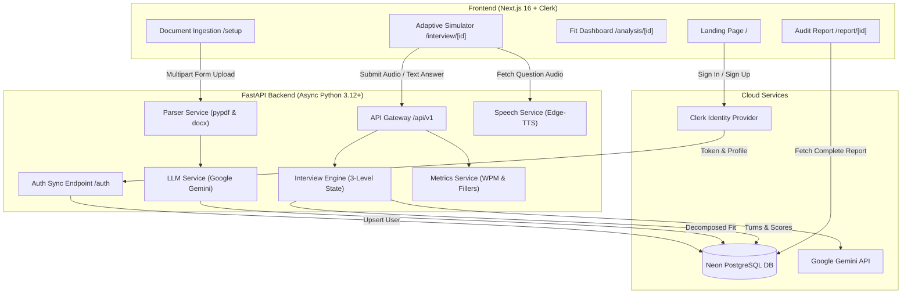

# Interview Accelerator ⚡
### Autonomous Multi-Modal AI Interview Simulator & Evaluation Engine

[](https://fastapi.tiangolo.com)
[](https://nextjs.org)
[](https://tailwindcss.com)
[](https://neon.tech)
[](https://ai.google.dev)
[](https://clerk.com)

---

## 📌 Overview

**Interview Accelerator** is a production-grade, AI-driven technical interview simulator. Unlike generic mock interview tools that ask static, scripted questions, Interview Accelerator ingests the candidate's actual resume and the target job description (JD) in-memory, identifies resume claims that require probing, and conducts a dynamic **3-Level progressive interview** with real-time speech telemetry, neural voice synthesis, and executive scorecards.

The user interface follows a high-contrast **Neo-Brutalist design system** (warm cream `#f5f0e7` base, white cards, thick `#101010` ink borders, hard offset drop shadows, and `Archivo Black` headers).

---

## 🌟 Core Features

- **Multi-Modal Document Parsing**: In-memory text extraction for `.pdf`, `.docx`, and `.txt` files without uploading to third-party file buckets.
- **Role & Job Fit Decomposition**: Calculates numerical fit score (0–100%), extracts must-have vs. preferred competencies, and flags suspicious or bold resume claims for follow-up questions.
- **3-Level Adaptive AI Interview Stage**:
  - **Level 1 (Screening)**: Motivation, career narrative, and verifying personal project contributions.
  - **Level 2 (Competency)**: Technical architecture, concurrency, database schema, and design tradeoffs.
  - **Level 3 (Deep-Dive)**: Probing vague claims, introducing edge cases, and testing composure under failure scenarios.
- **Real-Time Speech Delivery Telemetry**:
  - Velocity tracking: **Words Per Minute (WPM)** benchmarked against optimal conversational pace (110–165 WPM).
  - Verbal crutch analysis: Automatic counter and catalog of filler words (*"um"*, *"uh"*, *"like"*, *"basically"*).
- **Neural Voice & WebRTC Vision**:
  - Natural conversational TTS streaming via Microsoft Edge-TTS with audio replay controls.
  - Mirrored candidate webcam preview with persistent DOM stream attachment.
- **Clerk Authentication & Database Sync**:
  - Secure modal sign-in and sign-up with Clerk.
  - Automatic background synchronization into Neon PostgreSQL (`users` table) and session linking.
- **Post-Interview Diagnostic Report**:
  - 7-competency radar scores (*Role Fit, Technical Knowledge, Problem Solving, Communication, Confidence, Depth, Behavioural Fit*).
  - Question-by-question senior critique with ideal model answers.
  - Prioritized actionable study roadmap and one-click PDF export.

---

## 🏛️ System Architecture



---

## 🛠️ Tech Stack

### Frontend
- **Framework**: Next.js 16.4 (App Router, Turbopack, Partial Prerendering)
- **Language**: TypeScript 5
- **Styling**: Tailwind CSS v4 + Radix UI Primitives + Lucide Icons
- **Authentication**: `@clerk/nextjs`
- **Fonts**: `Archivo Black` (headers), `Roboto Mono` (telemetry & data)

### Backend
- **Framework**: FastAPI (Async ASGI) + Uvicorn
- **Language**: Python 3.12+
- **Database ORM**: SQLAlchemy 2.0 (Asyncio) + `asyncpg` driver + `greenlet`
- **Database**: Neon Serverless PostgreSQL
- **LLM Engine**: Google Gemini API (`google-genai` SDK) with multi-model fallback (`gemini-flash-lite-latest` &rarr; `gemini-flash-latest`)
- **Speech & Audio**: Microsoft `edge-tts`
- **Document Parsing**: `pypdf`, `python-docx`

---

## 💻 Local Installation & Setup

### 1. Prerequisites
Ensure you have the following installed:
- [Node.js](https://nodejs.org) (v18.18+ or v20+)
- [Python](https://www.python.org/downloads/) (v3.11, v3.12, or v3.13)
- [Git](https://git-scm.com)
- Free accounts for:
  - [Google AI Studio](https://aistudio.google.com/) (Gemini API Key)
  - [Neon Database](https://neon.tech/) (Serverless Postgres URL)
  - [Clerk](https://clerk.com/) (Publishable & Secret Keys)

---

### 2. Clone the Repository
```bash
git clone https://github.com/Sanyam26362/EDXSO-Assignment.git
cd EDXSO-Assignment
```

---

### 3. Backend Setup

1. **Navigate to the backend directory**:
   ```bash
   cd backend
   ```

2. **Create and activate a Python virtual environment**:
   ```bash
   # On Windows (PowerShell)
   python -m venv .venv
   .\.venv\Scripts\Activate.ps1

   # On macOS / Linux
   python3 -m venv .venv
   source .venv/bin/activate
   ```

3. **Install dependencies**:
   ```bash
   pip install -r requirements.txt
   ```

4. **Configure environment variables**:
   Create a `.env` file in the `backend/` directory based on `.env.example`:
   ```bash
   cp .env.example .env
   ```
   Fill in your credentials:
   ```env
   PORT=8000
   ENVIRONMENT=development

   # Neon Database URL
   DATABASE_URL=postgresql://<user>:<password>@<ep-pooler>.us-east-2.aws.neon.tech/neondb?sslmode=require

   # Google Gemini API
   GEMINI_API_KEY=your_gemini_api_key_here
   GROQ_API_KEY=your_groq_api_key_here

   # Clerk Authentication
   CLERK_SECRET_KEY=sk_test_...
   CLERK_PUBLISHABLE_KEY=pk_test_...

   # Optional Frontend URL for CORS
   FRONTEND_URL=http://localhost:3000
   ```

5. **Start the FastAPI server**:
   ```bash
   uvicorn app.main:app --host 127.0.0.1 --port 8000 --reload
   ```
   Verify backend health at: [http://127.0.0.1:8000/health](http://127.0.0.1:8000/health)  
   Interactive API docs (Swagger): [http://127.0.0.1:8000/docs](http://127.0.0.1:8000/docs)

---

### 4. Frontend Setup

1. **Open a new terminal and navigate to the frontend directory**:
   ```bash
   cd frontend
   ```

2. **Install Node packages**:
   ```bash
   npm install
   ```

3. **Configure environment variables**:
   Create a `.env.local` file in the `frontend/` directory based on `.env.example`:
   ```bash
   cp .env.example .env.local
   ```
   Add your keys:
   ```env
   NEXT_PUBLIC_API_URL=http://127.0.0.1:8000/api/v1

   # Clerk Keys
   NEXT_PUBLIC_CLERK_PUBLISHABLE_KEY=pk_test_...
   CLERK_SECRET_KEY=sk_test_...

   NEXT_PUBLIC_CLERK_SIGN_IN_URL=/
   NEXT_PUBLIC_CLERK_SIGN_UP_URL=/
   NEXT_PUBLIC_CLERK_AFTER_SIGN_IN_URL=/setup
   NEXT_PUBLIC_CLERK_AFTER_SIGN_UP_URL=/setup
   ```

4. **Start the Next.js development server**:
   ```bash
   npm run dev
   ```
   Open your browser at: [http://localhost:3000](http://localhost:3000)

---

## 🚀 Step-by-Step Deployment Guide

Follow this guide to deploy the full stack to production using **Render** (Backend) and **Vercel** (Frontend).

### Part A: Deploying Backend on Render

1. **Log in to [Render.com](https://render.com/)** and click **New + &rarr; Web Service**.
2. **Connect your GitHub repository** (`EDXSO-Assignment`).
3. **Configure Web Service settings**:
   - **Name**: `interview-accelerator-backend`
   - **Region**: Select closest to your Neon database (e.g., *Ohio / US East*).
   - **Root Directory**: `backend`
   - **Runtime**: `Python 3`
   - **Build Command**:
     ```bash
     pip install -r requirements.txt
     ```
   - **Start Command**:
     ```bash
     uvicorn app.main:app --host 0.0.0.0 --port $PORT
     ```
4. **Add Environment Variables**:
   Under **Environment Variables**, add:
   - `PYTHON_VERSION`: `3.12.8`
   - `ENVIRONMENT`: `production`
   - `DATABASE_URL`: `postgresql://<user>:<password>@<ep-pooler>.us-east-2.aws.neon.tech/neondb?sslmode=require`
   - `GEMINI_API_KEY`: `<your_gemini_api_key>`
   - `GROQ_API_KEY`: `<your_groq_api_key>`
   - `CLERK_SECRET_KEY`: `<your_clerk_secret_key>`
   - `CLERK_PUBLISHABLE_KEY`: `<your_clerk_publishable_key>`
   - `FRONTEND_URL`: (You can update this after Vercel deployment, e.g., `https://interview-accelerator.vercel.app`)
5. Click **Create Web Service**.
6. Once deployed, test the health check endpoint:
   `https://interview-accelerator-backend.onrender.com/health` &rarr; should return:
   ```json
   {"status":"ok","service":"Interview Accelerator","database":"connected"}
   ```

---

### Part B: Deploying Frontend on Vercel

1. **Log in to [Vercel.com](https://vercel.com/)** and click **Add New &rarr; Project**.
2. **Import your GitHub repository** (`EDXSO-Assignment`).
3. **Configure Project Settings**:
   - **Framework Preset**: `Next.js`
   - **Root Directory**: Click *Edit* and select `frontend`.
4. **Add Environment Variables**:
   - `NEXT_PUBLIC_API_URL`: `https://interview-accelerator-backend.onrender.com/api/v1` *(use your Render service URL + `/api/v1`)*
   - `NEXT_PUBLIC_CLERK_PUBLISHABLE_KEY`: `<your_clerk_publishable_key>`
   - `CLERK_SECRET_KEY`: `<your_clerk_secret_key>`
   - `NEXT_PUBLIC_CLERK_SIGN_IN_URL`: `/`
   - `NEXT_PUBLIC_CLERK_SIGN_UP_URL`: `/`
   - `NEXT_PUBLIC_CLERK_AFTER_SIGN_IN_URL`: `/setup`
   - `NEXT_PUBLIC_CLERK_AFTER_SIGN_UP_URL`: `/setup`
5. Click **Deploy**.
6. **Configure Clerk Production Domain**:
   - In your [Clerk Dashboard](https://dashboard.clerk.com), navigate to **Configure &rarr; Domains**.
   - Add your Vercel deployment domain (e.g., `https://your-app.vercel.app`) to allowed redirect origins.
7. Update `FRONTEND_URL` on your Render Web Service to match your Vercel production domain.

---

## 📡 API Reference

| Endpoint | Method | Description |
|---|---|---|
| `/health` | `GET` | Health check verifying API and active Neon DB connectivity |
| `/api/v1/auth/sync` | `POST` | Upserts Clerk authenticated user profile into PostgreSQL |
| `/api/v1/auth/user/{clerk_id}` | `GET` | Retrieves user profile and interview session history |
| `/api/v1/auth/link-session` | `POST` | Links an interview session to a specific user record |
| `/api/v1/analysis/upload` | `POST` | Ingests JD & Resume (file or text) and returns decomposed fit |
| `/api/v1/analysis/{session_id}` | `GET` | Retrieves stored fit analysis, ATS keywords, and probe areas |
| `/api/v1/interview/start` | `POST` | Idempotently initializes interview Level 1 question |
| `/api/v1/interview/turn` | `POST` | Submits candidate answer, computes WPM metrics, generates next question |
| `/api/v1/interview/{id}/turns` | `GET` | Retrieves all chronological turns and candidate answers |
| `/api/v1/voice/speak` | `POST` | Generates neural text-to-speech audio stream (MPEG) |
| `/api/v1/voice/transcribe` | `POST` | Transcribes candidate audio blob via Gemini Multimodal Audio |
| `/api/v1/evaluation/generate/{id}`| `POST` | Synthesizes 7-competency post-interview audit report |
| `/api/v1/evaluation/{id}` | `GET` | Retrieves completed evaluation report for session |

---

## 📂 Project Directory Structure

```
EDXSO-Assignment/
├── README.md                      # Comprehensive project documentation
├── .gitignore                     # Git ignore rules for secrets, DBs, and builds
├── backend/
│   ├── .env.example               # Example backend environment variables
│   ├── requirements.txt           # Python dependencies (FastAPI, asyncpg, Gemini)
│   ├── render.yaml                # Render Cloud Blueprint specification
│   └── app/
│       ├── main.py                # FastAPI initialization, CORS, lifespan
│       ├── core/
│       │   ├── database.py        # Asyncpg engine, SSL sanitizer, session factory
│       │   ├── config.py          # Environment settings
│       │   └── prompts.py         # System prompts for 3-Level interview & scoring
│       ├── models/
│       │   ├── db_models.py       # SQLAlchemy ORM (User, Session, Turn, Report)
│       │   └── schemas.py         # Pydantic schemas for request/response validation
│       ├── services/
│       │   ├── parser_service.py  # In-memory PDF, DOCX, and TXT extraction
│       │   ├── llm_service.py     # Gemini client with exponential retry & model fallback
│       │   ├── interview_engine.py# 3-level adaptive question & report generator
│       │   ├── metrics_service.py # Real-time WPM velocity & filler words analyzer
│       │   └── speech_service.py  # Edge-TTS voice synthesis
│       └── api/v1/
│           ├── api.py             # Router aggregation
│           └── endpoints/         # Auth, analysis, interview, voice, evaluation
└── frontend/
    ├── .env.example               # Example frontend environment variables
    ├── package.json               # Node dependencies (@clerk/nextjs, Radix, Tailwind)
    └── src/
        ├── app/
        │   ├── layout.tsx         # Root layout with ClerkProvider & ClerkUserSync
        │   ├── page.tsx           # Neo-Brutalist Landing Page with Clerk auth
        │   ├── setup/page.tsx     # Ingestion & ATS Match configuration
        │   ├── analysis/[id]/     # Role breakdown & Job Fit Score Gauge
        │   ├── interview/[id]/    # 3-Level Adaptive AI Simulator with Video/Audio
        │   └── report/[id]/       # Executive Evaluation Report & PDF export
        ├── components/
        │   ├── auth/              # Clerk user synchronizer component
        │   └── ui/                # Atomic Neo-Brutalist UI (Button, Card, Badge, Progress)
        ├── lib/
        │   ├── api.ts             # Typed API client for FastAPI backend
        │   └── sampleData.ts      # Sample AI Engineer Intern JD & Resume
        └── types/
            └── interview.ts       # TypeScript interfaces matching backend models
```

---

## 📜 License

This project is licensed under the [MIT License](LICENSE).
Built with open-source Neo-Brutalist UI principles for autonomous interview acceleration.
